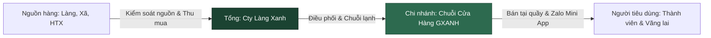

# KẾ HOẠCH PHÁT TRIỂN SẢN PHẨM: GXANH — TỪ LÀNG RA PHỐ
> **Nguồn cơ sở**: Báo cáo Định hướng Công nghệ GVOS (05/11/2026), Đặc tả Chân dung sản phẩm `docs/product/cho-xanh-quan-tri/40-chan-dung-san-pham.md`, Mô phỏng tương tác 32 màn hình và Kiến trúc lõi `gvos`.

---

## 1. TỔNG QUAN CHIẾN LƯỢC: PIVOT & REBRANDING

### 1.1. Quyết định chiến lược
* **Dừng phát triển**: Tính năng "Trợ lý đăng bán nông sản" (mô hình hộ nông dân tự đăng bán C2C/B2B rời rạc).
* **Chuyển trọng tâm (Pivot)**: Xây dựng hệ điều hành chuỗi bán lẻ nông sản khép kín **GXANH**.
* **Nhận diện thương hiệu mới**: 
  * Thương hiệu: **GXANH** (thay thế tên gọi cũ *Chợ Xanh*).
  * Slogan / Thông điệp: *"G Xanh — Từ Làng Ra Phố"*.
  * Chuỗi giá trị: Thu mua tại vùng sản xuất (công ty xã, HTX, hộ chuẩn) ➔ Tổng điều phối & kiểm soát chất lượng ➔ Chuỗi cửa hàng bán lẻ đô thị ➔ Người tiêu dùng cuối.

### 1.2. Triết lý vận hành & Giới hạn công nghệ (Học từ Sói Biển)
* **Nguyên tắc**: *Nguồn hàng và con người đi trước, công nghệ đi sau.*
* **Vai trò của công nghệ**: Chuẩn hóa quy trình ghi nhận, tự động hóa tính toán và nhắc việc đúng thời điểm, kiểm soát tuân thủ và chống gian lận/thất thoát. Công nghệ không thay thế được năng lực kinh doanh, chọn nguồn hàng sạch, kỹ năng đứng quầy và chăm sóc khách hàng trực tiếp.



---

## 2. KIẾN TRÚC MÔ HÌNH QUẢN TRỊ: 3 TẦNG & 2 VÒNG TIỀN

```mermaid
graph TD
    subgraph Vòng Tiền Thẻ [VÒNG TIỀN THẺ - NỢ KHÁCH HÀNG]
        T1["Khách nạp tiền qua VietQR"] -->|100% về thẳng| T2["Tài khoản Tổng (Cty Làng Xanh)"]
        T2 -->|Ghi nhận| T3["Sổ nghĩa vụ điểm (1 điểm = 1 đ)"]
        T3 -->|Khách tiêu tại cửa hàng qua QR 60s| T4["Đối soát & Quỹ Bù trừ T+1"]
        T4 -->|Trước 06:00 sáng hôm sau| T5["Chuyển tiền về Cửa hàng nhập hàng"]
    end

    subgraph Vòng Vốn Góp [VÒNG VỐN GÓP - CỔ ĐÔNG & ĐẦU TƯ]
        C1["Cổ đông góp vốn mở điểm"] --> C2["Tài khoản Vốn góp riêng từng chi nhánh"]
        C2 --> C3["Sổ cổ đông độc lập & Khoá vốn"]
        C3 --> C4["Nghị quyết chốt kỳ & Chia lợi nhuận"]
    end

    style Vòng Tiền Thẻ fill:#e8f5e9,stroke:#2e7d32,stroke-width:2px
    style Vòng Vốn Góp fill:#e3f2fd,stroke:#1565c0,stroke-width:2px
```

### Hai nguyên tắc bất biến:
1. **Tách biệt tuyệt đối 2 vòng tiền**: Tiền nạp thẻ thành viên (nợ dịch vụ phải trả bằng nông sản) và vốn góp đầu tư mở điểm của cổ đông **không bao giờ** nằm chung tài khoản hoặc hiển thị gộp trên bất kỳ báo cáo nào.
2. **Kế toán chuẩn MISA**: ERP GXANH là sổ nghiệp vụ thời gian thực, định kỳ chốt sổ và **xuất chứng từ sang MISA** cho bộ phận kế toán, không làm lại hệ thống kế toán từ đầu.

---

## 3. BA NHÓM GIAO DIỆN & MÀN HÌNH CHỦ LỰC

| Nhóm Actor | Nền tảng | Nhiệm vụ cốt lõi | 5 Màn hình chuẩn |
| :--- | :--- | :--- | :--- |
| **1. Người mua** *(Customer)* | Mobile Web / Zalo Mini App | Mua hàng minh bạch, thanh toán điểm, tra cứu nguồn gốc | 1. Chợ GXANH theo phiên<br>2. Chi tiết món hàng & nguồn gốc<br>3. Giỏ hàng & thanh toán<br>4. Thẻ thành viên (QR đổi 60s, 3 nguồn điểm)<br>5. Tra cứu tem GF-Track (3 tầng bằng chứng, 6 chặng) |
| **2. Người bán / Cửa hàng** *(Store POS)* | Máy quầy POS / Tablet / Mobile | Thao tác siêu tốc, cân lô, chặn date, kiểm soát két tiền | 1. Quầy POS bán hàng (chặn lô hết hạn, tự áp giá hạ cận hạn)<br>2. Nạp thẻ & Đăng ký thành viên (VietQR về Tổng)<br>3. Kết ca đối soát két theo mệnh giá (lệch phải giải trình)<br>4. Kho tươi sống & hao hụt (FEFO, chụp ảnh khi vượt mức)<br>5. Tổng quan cửa hàng (doanh thu 2 luồng, bù trừ T+1) |
| **3. Quản trị Tổng** *(HQ Ops & Admin)* | Desktop Dashboard | Giám sát tài chính toàn chuỗi, điều phối hàng & nhân sự | 1. Bảng điều khiển Tổng (nghĩa vụ điểm, quỹ bù trừ)<br>2. Bảng điều phối nguồn hàng ngày mai<br>3. Theo dõi chuyến giao hàng xe lạnh (nhiệt độ, định vị)<br>4. CRM chăm sóc 4 nhóm khách hàng mỗi ngày<br>5. Khoán KPI nhân viên (đo lường tự động từ sổ bán hàng) |

---

## 4. MA TRẬN 15 PHÂN HỆ & LỘ TRÌNH 3 GIAI ĐOẠN

Tổng số: **234 tính năng** đã đặc tả, phân bổ thành 3 giai đoạn triển khai:

```
┌────────────────────────────────────────────────────────────────────────┐
│ GIAI ĐOẠN 1: CỬA HÀNG ĐẦU TIÊN (P0) ─── 135 TÍNH NĂNG BẮT BUỘC         │
│ (POS tại quầy, Nạp/Trả điểm thẻ, Kho tươi sống, Đối soát T+1, Tem QR) │
└────────────────────────────────────┬───────────────────────────────────┘
                                     │
                                     ▼
┌────────────────────────────────────────────────────────────────────────┐
│ GIAI ĐOẠN 2: TỪ CỬA HÀNG THỨ HAI (P1) ─── +86 TÍNH NĂNG SCALE CHUỖI    │
│ (Lương, Khoán KPI tự động, Chia lợi nhuận, Bù trừ liên chi nhánh)     │
└────────────────────────────────────┬───────────────────────────────────┘
                                     │
                                     ▼
┌────────────────────────────────────────────────────────────────────────┐
│ GIAI ĐOẠN 3: MỞ RỘNG TOÀN DIỆN (P2) ─── +13 TÍNH NĂNG MỞ RỘNG          │
│ (Tối ưu hóa sâu, Phân tích dự báo chuỗi cung ứng nâng cao)            │
└────────────────────────────────────────────────────────────────────────┘
```

### Chi tiết 15 Phân hệ theo 7 Khối Nghiệp vụ:

| Khối Nghiệp Vụ | Mã | Tên Phân Hệ | Tổng | P0 (Cửa hàng 1) | P1 (Từ CH 2) | P2 (Mở rộng) |
| :--- | :--- | :--- | :---: | :---: | :---: | :---: |
| **1. Điều hành chuỗi** | `TONG` | Quản trị Tổng & Chính sách | 18 | **11** | 6 | 1 |
| | `HT` | Hệ thống & Phân quyền RBAC | 20 | **13** | 6 | 1 |
| **2. Vòng tiền thẻ** | `THE` | Quản trị thẻ & Điểm thành viên | 18 | **13** | 4 | 1 |
| | `HH` | Hoa hồng giới thiệu 1 tầng | 9 | **7** | 2 | 0 |
| | `DS` | Đối soát & Quỹ Bù trừ T+1 | 14 | **11** | 3 | 0 |
| **3. Vòng vốn góp** | `CD` | Sổ cổ đông cửa hàng | 11 | **9** | 2 | 0 |
| | `LN` | Chia lợi nhuận theo nghị quyết | 5 | **0** | 4 | 1 |
| **4. Kế toán** | `KT` | Kế toán & Xuất chứng từ MISA | 11 | **7** | 3 | 1 |
| **5. Cửa hàng & Khách** | `CN` | Quản trị chi nhánh | 15 | **10** | 3 | 2 |
| | `POS` | Bán hàng tại quầy | 20 | **17** | 3 | 0 |
| | `KH` | Khách hàng & CRM | 16 | **7** | 8 | 1 |
| **6. Hàng tươi & Nguồn**| `KHO`| Kho tươi sống & Hao hụt | 24 | **17** | 6 | 1 |
| | `NC` | Nguồn cung & Công ty xã | 23 | **12** | 8 | 3 |
| **7. Con người** | `NS` | Hành chính & Nhân sự | 16 | **1** | 14 | 1 |
| | `NV` | Khoán KPI & Thưởng phạt | 14 | **0** | 14 | 0 |
| **TỔNG CỘNG** | | **15 phân hệ** | **234** | **135** | **86** | **13** |

---

## 5. KẾ HOẠCH HÀNH ĐỘNG TRIỂN KHAI (ACTION PLAN)

### 🎯 Sprint 1: Chuẩn hóa Nhận diện & Khung Core Giai đoạn 1 (Tuần 1–2)
1. **Rebranding**: 
   - Thay toàn bộ logo, nhãn, chuỗi text từ *Chợ Xanh* sang **GXANH — Từ Làng Ra Phố** trên giao diện Web (`gvos-web`), Control Plane (`cp-web`) và Mobile.
2. **Củng cố 2 Vòng tiền & Data Schema**:
   - Xác thực schema Prisma cho tài khoản Tổng, sổ nghĩa vụ điểm thẻ (`THE`), bảng bù trừ T+1 (`DS`) và sổ cổ đông độc lập (`CD`).
   - Đảm bảo webhook VietQR nạp thẻ ghi nhận tự động vào tài khoản Tổng.

### 🎯 Sprint 2: Hoàn thiện POS Quầy & Kho Tươi Sống (Tuần 3–4)
1. **Quầy POS (`gvos-web/src/pages/pos`)**:
   - Hỗ trợ cân theo lô (hàng ký), tự động chặn lô quá hạn sử dụng, gợi ý lô thay thế.
   - Cơ chế tự động áp giá hạ cận hạn (khung giờ chiều 14h–21h).
   - Thanh toán kép: Trừ điểm thẻ (quét mã QR động 60s) hoặc Tiền mặt / Chuyển khoản.
2. **Kết ca & Kiểm soát tiền mặt**:
   - Màn hình đếm két tiền theo từng mệnh giá, so khớp với doanh thu phần mềm ghi nhận.
   - Bắt buộc ghi nhận lý do và cần tài khoản quản lý xác nhận nếu có chênh lệch.
3. **Kho tươi sống (`KHO`)**:
   - Quy trình xuất nhập theo hạn dùng (FEFO).
   - Ghi nhận hao hụt chi tiết theo từng lô + lý do (héo, dập, hỏng) + chụp ảnh hiện trường khi vượt định mức.

### 🎯 Sprint 3: Quản trị Bù trừ T+1 & Truy xuất GF-Track (Tuần 5–6)
1. **Quỹ bù trừ & Chuyển tiền T+1**:
   - Tự động tổng hợp số tiền cửa hàng đã bán qua thẻ trong ngày vào lúc 00:00.
   - Tạo lệnh bù trừ tự động chuyển tiền về tài khoản cửa hàng trước 06:00 sáng.
2. **Tem truy xuất GF-Track**:
   - Cổng tra cứu nguồn gốc cho khách hàng quét QR trên tem sản phẩm (không cần tải app).
   - Hiển thị 3 tầng bằng chứng: Nhật ký vùng trồng, đối chứng chuỗi lạnh và chứng nhận kiểm nghiệm.

### 🎯 Sprint 4: Chạy Thí điểm Cửa hàng số 1 & Tinh chỉnh (Tuần 7–8)
1. **Chốt điểm bán thí điểm**: Lựa chọn 01 cửa hàng GXANH tại Hà Nội (Ví dụ: GXANH Hà Đông).
2. **Đo lường 5 chỉ số vận hành cốt lõi**:
   - Tỷ lệ sai lệch két tiền cuối ca: `< 0.05%`.
   - Tỷ lệ hao hụt hàng tươi sống trong ngày: `< 3.5%`.
   - Thời gian xử lý 1 giao dịch tại quầy: `< 45 giây`.
   - Tỷ lệ chuyển bù trừ tiền T+1 đúng hạn trước 06:00: `100%`.
   - Tỷ lệ khách hàng kích hoạt thẻ thành viên mới tại quầy.
