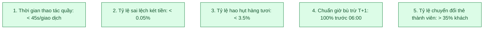

# KẾ HOẠCH TỔNG THỂ CHỨC NĂNG VÀ KIẾN TRÚC UI/UX HỆ THỐNG GXANH
> **Tài liệu nền tảng**: Báo cáo Định hướng Công nghệ GXANH (05/11/2026), Đặc tả Chân dung sản phẩm 40-chan-dung-san-pham.md, Nhu cầu Actor (ss1-nhu-cau-actor), Cấu trúc thông tin IA (ss2-ux-ui), Yêu cầu phi chức năng NFR-01 đến NFR-45 và Tiêu chuẩn Shopee UI/UX.

---

## 1. NGUYÊN TẮC THIẾT KẾ UX CỐT LÕI (UX PHILOSOPHY)

Hệ thống GXANH không phải là một sàn thương mại điện tử thông thường. Đây là một **Hệ điều hành bán lẻ nông sản khép kín (Retail ERP & Closed-loop Loyalty)** giải quyết bài toán niềm tin và kiểm soát dòng tiền:
1. **Nguồn hàng & Con người đi trước — Công nghệ theo sau**: Mọi màn hình được thiết kế để *chuẩn hóa ghi nhận, nhắc việc đúng thời điểm và ngăn chặn gian lận/thất thoát*, không làm phức tạp hóa thao tác quầy.
2. **Nguyên tắc "3 Nhịp Quầy"**: Mọi thao tác bán lẻ tại quầy của thu ngân phải hoàn thành trong **dưới 45 giây/giao dịch**, quét mã/cân lô dưới **0.5 giây**.
3. **Minh bạch hóa 2 vòng tiền**: Tuyệt đối không để xảy ra tình trạng mập mờ giữa tiền nạp thẻ thành viên (nợ khách hàng) và vốn góp đầu tư của cổ đông.
4. **Cơ chế phục hồi lỗi (Fault-tolerant & Graceful Degradation)**: Trong bán lẻ thực phẩm tươi sống, sự cố là chắc chắn xảy ra (mất mạng, rau dập nát, chuyển khoản sai cú pháp, lệch két, tem QR bị sao chép). Mọi luồng tính năng bắt buộc phải có **Error Case** và **Cách khắc phục rõ ràng**.

---

## 2. MA TRẬN TỔNG THỂ 4 NHÓM USER & CÁC CHỨC NĂNG

```
┌──────────────────────────────────────────────────────────────────────────────────┐
│                                HỆ ĐIỀU HÀNH GXANH                                │
├─────────────────┬──────────────────┬──────────────────────┬──────────────────────┤
│ 1. NGƯỜI MUA    │ 2. NHÂN VIÊN     │ 3. QUẢN LÝ CỬA HÀNG  │ 4. QUẢN TRỊ TỔNG     │
│ (Consumer App)  │ (Quầy & Kho)     │ (Store Manager)      │ (HQ Command Center)  │
├─────────────────┼──────────────────┼──────────────────────┼──────────────────────┤
│ • Chợ theo phiên│ • Bán hàng POS   │ • Duyệt chênh ca     │ • Bảng điều khiển    │
│ • Chi tiết món  │ • Cân theo lô    │ • Duyệt hao hụt vượt │ • Quỹ bù trừ T+1     │
│ • Đơn đặt trước │ • Chặn date FEFO │ • Duyệt hạ giá chiều │ • Điều phối ngày mai │
│ • Thẻ Zalo QR   │ • Nạp thẻ VietQR │ • Theo dõi dòng T+1  │ • Quản lý chuỗi lạnh │
│ • Tra cứu tem   │ • Đếm két kết ca │ • Khoán KPI & quỹ ca │ • CRM 4 nhóm khách   │
│   GF-Track      │ • Nhận hàng kho  │ • Quản lý khiếu nại  │ • Sổ cổ đông & MISA  │
└─────────────────┴──────────────────┴──────────────────────┴──────────────────────┘
```

---

## 3. ĐẶC TẢ CHI TIẾT TỪNG USER FLOW: USER ➔ FLOW ➔ PERFECT CASE ➔ ERROR CASE ➔ KHẮC PHỤC

---

### PHÂN HỆ A: NGƯỜI TIÊU DÙNG (CONSUMER APP & ZALO MINI APP)

#### Chức năng A1: Mua Nông Sản Trực Tuyến & Theo Phiên Chợ
* **User**: Khách hàng thành viên (`THANH-VIEN`) và Khách vãng lai (`VANG-LAI`).
* **Mục đích**: Xem hàng tươi theo phiên chợ trong ngày, chọn nguồn gốc thôn làng, đặt giao hỏa tốc hoặc nhận tại quầy.
* **User Flow**:
  1. Mở app/web ➔ Nhìn thấy Banner phiên chợ (Đồng Lam, Quy Đức...) kèm đồng hồ đếm ngược giờ chốt phiên.
  2. Lướt qua danh mục hoặc tìm kiếm theo thôn/món ➔ Xem thẻ sản phẩm (ảnh thật, nguồn gốc, giá, tem GF-Track, số lượng đã bán).
  3. Bấm xem chi tiết ➔ Chọn quy cách đóng gói (500g, 1kg, hũ 500ml...) ➔ Chọn số lượng.
  4. Thêm vào giỏ ➔ Vào giỏ hàng ➔ Chọn hình thức nhận (Giao hỏa tốc 2h hoặc Nhận tại cửa hàng).
  5. Chọn phương thức thanh toán (Trừ điểm thẻ hoặc Chuyển khoản VietQR) ➔ Hoàn tất đơn.

* **Perfect Case (Happy Path)**:
  * Hàng còn đủ tồn kho tại cửa hàng gần nhất. Khách chọn trừ điểm thẻ thành viên, số dư điểm đủ, hệ thống trừ điểm tự động, tạo đơn hàng trong 1.5 giây, sinh mã đơn `DH-xxxx` và gửi thông báo xác nhận.

* **Error Cases & Sự cố thực tế**:
  1. **Lỗi hết tồn kho đột xuất (OOS - Out of Stock)**: Hàng tươi sống tại quầy vừa bán hết cho khách trực tiếp nhưng trên app vẫn còn hiển thị số lượng.
  2. **Lỗi vượt bán kính giao hỏa tốc**: Địa chỉ khách hàng cách cửa hàng quá 10km, không đảm bảo chuỗi lạnh 2-4°C.
  3. **Lỗi gián đoạn mạng khi trừ điểm**: Khách bấm "Đặt hàng", mạng chập chờn dẫn đến gửi yêu cầu 2 lần (nguy cơ trừ điểm trùng).

* **Cách khắc phục & Thiết kế UX phục hồi**:
  * *Xử lý OOS*: Khóa tồn kho tạm thời (hold stock) trong 10 phút ngay khi khách vào bước thanh toán. Nếu thực tế quầy đã hết, hệ thống hiển thị ngay Pop-up gợi ý: *"Rau su su tại CH Hà Đông vừa hết, bạn có muốn điều chuyển từ CH Cầu Giấy (thêm 30 phút) hoặc đổi sang Ngọn bí non cùng vùng trồng?"*.
  * *Xử lý bán kính*: Tự động định vị GPS hoặc kiểm tra phường/quận. Nếu ngoài bán kính 5km, cảnh báo ngay: *"Địa chỉ nằm ngoài vùng giao hỏa tốc rau mát. Chuyển sang chuyến giao gom cố định ngày mai để đảm bảo độ tươi"*.
  * *Xử lý trừ trùng (Idempotency)*: Mọi nút bấm đặt hàng có trạng thái `disabled + spinner` ngay khi chạm; API sử dụng `Idempotency-Key` (kết hợp `userId + timestamp_phút + cart_hash`), nếu bấm lặp hệ thống chỉ thực thi đúng 1 lệnh duy nhất.

---

#### Chức năng A2: Nạp Tiền & Sử Dụng Thẻ Thành Viên (Zalo Mini App)
* **User**: Khách hàng thành viên (`THANH-VIEN`).
* **Mục đích**: Nạp tiền qua VietQR tập trung về Tổng, tích lũy điểm không hoàn tiền mặt (1 điểm = 1đ), lấy mã QR động dùng 1 lần thanh toán tại quầy.
* **User Flow**:
  1. Mở Zalo Mini App ➔ Xuất trình Digital Pass hiển thị số dư 3 nguồn: Điểm nạp, Điểm thưởng, Hoa hồng F1.
  2. *Khi nạp tiền*: Bấm [Nạp Điểm] ➔ Chọn gói nạp (200k, 500k, 1tr, 2tr) ➔ Đọc điều khoản cam kết không hoàn tiền mặt ➔ Quét mã VietQR chuyển khoản với nội dung định danh `NAP <MaThe>`.
  3. *Khi thanh toán tại quầy*: Chạm vào tab [QR Thanh toán] ➔ Màn hình hiển thị mã QR động với vòng tròn đếm ngược **60 giây** ➔ Đưa thu ngân quét trừ điểm ➔ Nhận thông báo biến động điểm tức thì.

* **Perfect Case (Happy Path)**:
  * Khách chuyển tiền đúng cú pháp, webhook ngân hàng báo về tài khoản Tổng trong 3 giây ➔ Điểm cộng vào tài khoản, Zalo gửi tin nhắn thông báo. Khi quẹt mã tại quầy, mã QR hợp lệ trong 60s, trừ điểm chính xác, mã tự hủy và sinh mã mới cho lần sau.

* **Error Cases & Sự cố thực tế**:
  1. **Chuyển khoản sai cú pháp hoặc sai số tiền**: Khách chuyển 500.000đ nhưng nội dung ghi nhầm tên hoặc thiếu mã thẻ.
  2. **Quét ảnh chụp màn hình QR tĩnh (Gian lận)**: Khách chụp lại màn hình QR hoặc gửi cho người khác đi mua hộ sau nhiều giờ.
  3. **Mã QR hết hạn ngay trước khi thu ngân bấm quét**: Đồng hồ đếm về 0 đúng khoảnh khắc máy quét tia laser.
  4. **Khách đòi rút điểm ra tiền mặt**: Thành viên không còn nhu cầu mua hàng, đến quầy hoặc gọi hotline đòi rút lại số dư 500.000 điểm thành tiền mặt.

* **Cách khắc phục & Thiết kế UX phục hồi**:
  * *Xử lý sai cú pháp*: Giao diện nạp thẻ hiển thị nút copy thông minh cả STK và Nội dung. Nếu giao dịch bị treo, giao diện hiển thị trạng thái *"Đang chờ ngân hàng xác nhận (khoảng 1-3 phút)"* kèm nút *"Tôi đã chuyển khoản nhưng chưa thấy điểm"*, cho phép tải ảnh biên lai ngân hàng để Kế toán Tổng duyệt tay trong vòng 15 phút.
  * *Chống gian lận QR tĩnh*: Mã QR được mã hóa token JWT động kèm `exp: 60s` và `nonce` một lần. Khi chụp ảnh màn hình, ứng dụng phát hiện và làm mờ mã, đồng thời máy POS thu ngân sẽ từ chối với thông báo: *"Mã QR đã hết hiệu lực hoặc chụp lại. Vui lòng yêu cầu khách mở app trực tiếp"*.
  * *Xử lý QR hết hạn cận biên*: Hệ thống cho phép grace period (độ trễ chấp nhận) thêm **15 giây** ở backend nếu mã được máy POS đọc tại giây 59. Nếu trượt, app tự động tái sinh mã mới trong 0.2 giây mà không cần khách bấm tải lại trang.
  * *Chống đòi tiền mặt (Tuân thủ Điều khoản `CK-01`)*: Ngay tại bước nạp thẻ, bắt buộc hiển thị Checkbox in đậm: *"Tôi hiểu rằng điểm nạp chỉ dùng mua nông sản tại chuỗi GXANH, không quy đổi thành tiền mặt dưới mọi hình thức"*. Khi khách bấm xem số dư, luôn có chú thích pháp lý rõ ràng.

---

#### Chức năng A3: Tra Cứu Nguồn Gốc GF-Track (Không Cần Cài App)
* **User**: Người tiêu dùng mua hàng tại kệ (`THANH-VIEN` hoặc `VANG-LAI`).
* **Mục đích**: Quét tem QR dán trên bao bì sản phẩm (khay su su, túi chè, vỉ thịt) để xác thực tính chính hãng và xem toàn bộ bằng chứng từ vùng trồng.
* **User Flow**:
  1. Dùng camera điện thoại thông thường quét mã QR trên tem khay sản phẩm.
  2. Mở đường link web công khai `track.gxanh.vn/lo/<MaLo>` (tốc độ tải < 1 giây, dung lượng nhẹ).
  3. Xem trạng thái xác thực: Huy hiệu xanh *"Chính hãng GF-Track · Quét lần 1 tại Cửa hàng GXANH Hà Đông"*.
  4. Xem 3 Tầng Bằng Chứng:
     - Tầng 1: Nhật ký vùng trồng tự khai (Ảnh GPS thửa ruộng, phân bón vi sinh, thời gian cách ly).
     - Tầng 2: Đối chứng vận hành chuỗi (Biên bản xe lạnh 3.2°C, cân bằng khối lượng 100%).
     - Tầng 3: Pháp lý & Kiểm nghiệm (Mã số vùng trồng, chứng nhận VietGAP, phiếu kiểm nghiệm 0% dư lượng).
  5. Xem Hành trình 6 chặng từ lúc thu hoạch đến khi lên kệ.
  6. Gửi phản hồi chất lượng kèm ảnh nếu sản phẩm có vấn đề.

* **Perfect Case (Happy Path)**:
  * Tem hợp lệ, quét lần đầu tiên, hiển thị đầy đủ ảnh chụp thực tế tại ruộng ngày hôm qua, kết quả kiểm nghiệm đạt chuẩn, khách hàng hoàn toàn tin tưởng mua hàng.

* **Error Cases & Sự cố thực tế**:
  1. **Tem bị quét lặp nhiều lần (Nghi vấn tem bị sao chép/in lậu)**: Tem dán trên khay su su bị quét lần thứ 15 ở các vị trí địa lý khác nhau.
  2. **Lô hàng bị thu hồi hoặc đã hết hạn dùng**: Khách quét phải sản phẩm đã quá hạn bảo quản hoặc đang có lệnh phong tỏa chất lượng từ Tổng.
  3. **Vùng trồng chưa kịp đồng bộ ảnh nhật ký**: Do mất sóng 4G ở vùng sâu vùng xa, dữ liệu chặng thu hoạch chưa đẩy đủ ảnh lên hệ thống.

* **Cách khắc phục & Thiết kế UX phục hồi**:
  * *Cảnh báo tem sao chép*: Nếu số lượt quét `> 3 lần` ở các thiết bị/IP khác nhau, huy hiệu đổi sang màu vàng cảnh báo: *"Cảnh báo: Mã tem này đã được quét 4 lần. Hãy kiểm tra niêm phong vỉ khay hoặc báo ngay cho nhân viên cửa hàng"*.
  * *Xử lý lô thu hồi/hết hạn*: Màn hình chuyển sang màu đỏ cảnh báo khẩn: *"Cảnh báo an toàn: Lô hàng này đã quá hạn sử dụng khuyến nghị (ngày 06/11/2026). Quý khách vui lòng không sử dụng và đổi trả ngay tại quầy để được hoàn tiền 100%"*.
  * *Xử lý thiếu ảnh nhật ký*: Không để trống màn hình; hiển thị trạng thái minh bạch: *"Dữ liệu vùng trồng đang được đồng bộ vệ tinh từ Xã Quy Đức. Đã xác thực qua biên bản giấy giao nhận số #BB-902 lúc 05:18 sáng"*.

---

### PHÂN HỆ B: NHÂN VIÊN BÁN HÀNG & THỦ KHO CỬA HÀNG

#### Chức năng B1: Quầy Bán Hàng POS & Chặn Lô Hết Hạn
* **User**: Thu ngân cửa hàng (`THU-NGAN`).
* **Mục đích**: Bán hàng tốc độ cao, hỗ trợ cân hàng tươi sống theo ký, tự động áp giá hạ cận hạn và chặn bán thực phẩm hết hạn.
* **User Flow**:
  1. Đăng nhập ca làm việc ➔ Mở màn hình POS bán hàng.
  2. Quét mã vạch lô hoặc chọn món cân ký ➔ Đặt lên cân điện tử, hệ thống tự nhận khối lượng (ví dụ: 0.85 kg).
  3. Hệ thống kiểm tra hạn dùng của lô:
     - Nếu lô bình thường: Giữ nguyên giá niêm yết.
     - Nếu lô cận hạn và đang trong khung giờ chiều (sau 14:00): Tự động giảm giá theo chính sách (ví dụ: giảm từ 210k ➔ 147k/kg).
     - Nếu lô đã quá hạn sử dụng: Hệ thống rung chuông báo động đỏ và chặn không cho thêm vào giỏ.
  4. Chọn thanh toán: Trừ điểm thẻ thành viên (quét QR Zalo của khách) hoặc Tiền mặt / Chuyển khoản VietQR.
  5. In hóa đơn bán lẻ trong 2 giây ➔ Hoàn tất đơn.

* **Perfect Case (Happy Path)**:
  * Thu ngân cân 3 món rau củ và quét 2 gói đặc sản trong 30 giây. Máy tự động tính đúng chiết khấu giờ chiều. Khách đưa mã QR Zalo, máy POS quét "bíp", trừ điểm thành công, in hóa đơn và mở két tiền tự động.

* **Error Cases & Sự cố thực tế**:
  1. **Thu ngân cố tình quét lô đã hết hạn**: Khách nhặt nhầm khay rau hết hạn từ hôm qua trên kệ.
  2. **Cửa hàng bị mất kết nối Internet trong giờ cao điểm**: Cáp quang bị đứt, máy POS không kết nối được với máy chủ Tổng.
  3. **Khách quét mã trừ điểm nhưng số dư thẻ không đủ**: Đơn hàng 250.000đ nhưng thẻ chỉ còn 180.000 điểm.
  4. **Cân điện tử bị nhảy số hoặc sai lệch**: Cân bị lệch trọng lượng do gió hoặc đặt không cân bằng.

* **Cách khắc phục & Thiết kế UX phục hồi**:
  * *Chặn tuyệt đối lô hết hạn*: Máy POS hiện Modal đỏ chiếm toàn màn hình: *"NGĂN CHẶN: Lô su su LO-261101 đã hết hạn lúc 00:00 hôm nay. Tuyệt đối không bán cho khách. Hãy thu hồi và mang vào kho lập biên bản hao hụt hủy"*. Hệ thống khóa nút thanh toán cho đến khi xóa dòng này.
  * *Xử lý mất mạng (Theo luật `NFR-05, NFR-06`)*:
    - **Thanh toán tiền mặt**: Cho phép chuyển sang chế độ *Offline Mode*, lưu trữ cục bộ trên trình duyệt/máy quầy. Khi có mạng trở lại, máy tự động đồng bộ lên server theo cơ chế Outbox (`Law 4`).
    - **Thanh toán bằng Thẻ điểm**: **BẮT BUỘC CHẶN** khi mất mạng vì không thể xác thực số dư thời gian thực với tài khoản Tổng (nguy cơ trừ âm thẻ hoặc gian lận). Hiển thị hướng dẫn: *"Mạng gián đoạn: Tạm thời không thể trừ điểm thẻ. Vui lòng hướng dẫn khách trả tiền mặt hoặc chuyển khoản VietQR tĩnh"*.
  * *Xử lý thiếu điểm (Split Payment)*: Giao diện POS tự động đề xuất luồng thanh toán kết hợp: *"Trừ toàn bộ 180.000 điểm trên thẻ ➔ Thu phần còn lại 70.000đ bằng tiền mặt hoặc chuyển khoản"*.
  * *Xử lý cân lệch*: Nút [Cân lại / Zero] to 48px trên màn hình cảm ứng giúp thu ngân lấy lại mốc 0g trong 1 chạm.

---

#### Chức năng B2: Kết Ca & Đối Soát Tiền Mặt Két
* **User**: Thu ngân bàn giao (`THU-NGAN`) và Quản lý cửa hàng nhận ca (`QL-CH`).
* **Mục đích**: Kiểm đếm tiền mặt thực tế trong két theo từng mệnh giá, so khớp với doanh thu phần mềm, xác lập trách nhiệm cá nhân.
* **User Flow**:
  1. Cuối ca, thu ngân bấm [Kết ca] trên POS.
  2. Màn hình hiển thị bảng nhập mệnh giá: Đếm số lượng tờ tiền 500k, 200k, 100k, 50k, 20k, 10k...
  3. Hệ thống tự động tính ra "Tiền thực đếm" và so sánh với "Tiền mặt phải có" (Đầu ca + Thu trong ca - Chi có chứng từ).
  4. Nếu lệch: Bắt buộc chọn lý do và giải trình.
  5. Quản lý cửa hàng đăng nhập tài khoản riêng để ký duyệt biên bản bàn giao két.

* **Perfect Case (Happy Path)**:
  * Tiền thực đếm khớp chính xác từng đồng với tiền phần mềm (Chênh lệch = 0đ). Hai bên bấm xác nhận trong 2 phút, in biên bản bàn giao, tiền thừa nộp vào két sắt an toàn.

* **Error Cases & Sự cố thực tế**:
  1. **Thiếu tiền két (Ví dụ: Thiếu 20.000đ hoặc 200.000đ)**: Do trả lại tiền thừa nhầm cho khách vãng lai trong ca đông đúc.
  2. **Thừa tiền két**: Do khách không lấy tiền thừa lẻ hoặc quên thối tiền.
  3. **Thu ngân tự ý kết ca một mình không có quản lý**: Thu ngân vội về, tự xác nhận biên bản.

* **Cách khắc phục & Thiết kế UX phục hồi**:
  * *Kiểm soát chênh lệch (Luật `CK-12`)*: Nếu chênh lệch `!= 0`:
    - Dưới 50.000đ: Cho phép ghi nhận lý do *"Trả nhầm tiền lẻ"* nhưng vẫn lưu vết KPI kỷ luật quầy.
    - Trên 50.000đ: Hộp nhập giải trình bắt buộc tối thiểu 20 ký tự. Hệ thống cảnh báo: *"Chênh lệch vượt ngưỡng an toàn. Bắt buộc có chữ ký xác nhận của Quản lý cửa hàng"*.
  * *Nguyên tắc 2 người (Two-man Rule)*: Màn hình khóa cứng nút [Hoàn tất kết ca], yêu cầu Quản lý cửa hàng dùng tài khoản riêng hoặc quẹt thẻ RFID/vân tay của quản lý để mở khóa. Tuyệt đối không cho phép dùng chung tài khoản thu ngân.

---

#### Chức năng B3: Quản Lý Kho Tươi Sống & Ghi Hao Hụt Thực Phẩm
* **User**: Thủ kho (`THU-KHO`) và Quản lý cửa hàng (`QL-CH`).
* **Mục đích**: Nhập hàng từ xe lạnh, kiểm tra hạn dùng (FEFO), ghi nhận hao hụt thực phẩm (dập, héo, hỏng) có kèm bằng chứng hình ảnh.
* **User Flow**:
  1. Lúc 05:30 sáng, xe tải lạnh giao hàng tới cửa hàng ➔ Thủ kho mở app Kho.
  2. Cân đối chứng khối lượng thực nhận vs phiếu giao hàng của Tổng ➔ Bấm xác nhận nhập kho.
  3. Trong ngày (đặc biệt khung giờ 14:00 và 20:00): Kiểm tra các lô rau củ thịt cá trên kệ.
  4. Nếu phát hiện hàng héo, dập hoặc quá hạn: Chọn lô ➔ Bấm [Ghi hao hụt] ➔ Chọn loại lý do (Héo ngọn, Dập cuống, Hỏng ruột, Rơi vỡ) ➔ Nhập số ký/số đơn vị.
  5. Nếu vượt ngưỡng định mức (ví dụ > 3% khối lượng lô): Bắt buộc mở camera chụp ảnh hiện trường.
  6. Quản lý cửa hàng bấm duyệt phiếu hao hụt để ghi nhận chi phí vào sổ cái.

* **Perfect Case (Happy Path)**:
  * Rau củ nhập kho đủ 100% cân nặng, nhiệt độ xe 3.2°C đạt chuẩn. Tỷ lệ hao hụt trong ngày dưới 2.5%, phiếu hao hụt được duyệt nhanh chóng, giá vốn được cập nhật chính xác.

* **Error Cases & Sự cố thực tế**:
  1. **Thất thoát ngầm / Báo khống hao hụt**: Nhân viên tuồn hàng ra ngoài rồi khai báo là "rau hỏng đã đổ bỏ".
  2. **Hàng giao từ xe lạnh bị thiếu hụt so với lệnh điều phối**: Xe lạnh giao thiếu 5kg thịt bản.
  3. **Nhân viên quên kiểm tra hạn dùng, để rau quá hạn trên kệ quầy**: Gây rủi ro an toàn thực phẩm nếu khách mua phải.

* **Cách khắc phục & Thiết kế UX phục hồi**:
  * *Chống khai khống hao hụt*: Hệ thống so sánh thời gian thực với **Định mức hao hụt chuẩn** từng nhóm hàng (ví dụ: Rau ăn lá tối đa 4%, củ quả tối đa 1.5%, thịt tươi tối đa 0.8%). Vượt định mức bắt buộc chụp 2 ảnh hiện trường góc rộng + góc cận; vị trí GPS máy phải nằm tại tọa độ cửa hàng.
  * *Xử lý thiếu hàng khi nhận*: Tại màn hình nhập kho, nếu khối lượng thực nhận lệch `> 1%` so với phiếu giao, hệ thống hiển thị nút: *"Ký nhận có chênh lệch"*, tự động tạo biên bản phạt nhà cung cấp/tài xế và thông báo khẩn về bộ phận Điều phối Tổng.
  * *Nhắc việc tự động*: Vào 13:45 hàng ngày, hệ thống đẩy thông báo Toast & Rung chuông trên máy bảng quầy: *"Đã đến giờ rà soát hạn dùng và kích hoạt giá hạ chiều cho 6 lô rau củ!"*.

---

### PHÂN HỆ C: QUẢN LÝ CỬA HÀNG (STORE OPERATIONS & DASHBOARD)

#### Chức năng C1: Dashboard Quản Trị Cửa Hàng & Bù Trừ Dòng Tiền T+1
* **User**: Quản lý cửa hàng (`QL-CH`).
* **Mục đích**: Theo dõi doanh thu 2 luồng (Điểm thẻ vs Tiền mặt), giám sát dòng tiền bù trừ T+1 từ Tổng về tài khoản cửa hàng trước 06:00 sáng để có tiền nhập hàng.
* **User Flow**:
  1. Đăng nhập Dashboard cửa hàng trên máy tính hoặc tablet.
  2. Xem tổng quan ngày: Doanh thu bán hàng, số thành viên mới phát hành thẻ, tỷ lệ hao hụt.
  3. Xem mục **Dòng tiền bù trừ T+1 từ Tổng**:
     - Doanh thu quẹt thẻ hôm nay: Ví dụ 2.914.000đ.
     - Số tiền Tổng phải bù trừ về cửa hàng: 2.914.000đ (chốt lúc 00:00).
     - Hạn chuyển tiền: Trước **06:00 sáng hôm sau**.
     - Trạng thái: *Đang chờ Tổng chuyển / Đã chuyển thành công kèm sao kê*.
  4. Hộp việc chờ duyệt: 3 phiếu hao hụt kho, 1 biên bản kết ca lệch tiền, 2 yêu cầu hạ giá cận hạn.

* **Perfect Case (Happy Path)**:
  * Doanh thu thẻ được Tổng đối soát tự động lúc 00:00. Lúc 05:15 sáng, hệ thống ngân hàng tự động chuyển tiền bù trừ về tài khoản cửa hàng. Quản lý mở app lúc 06:00 thấy dòng chữ xanh: *"Tiền bù trừ T+1 đã về tài khoản 100% · Sẵn sàng chi tiền nhập hàng sáng"*.

* **Error Cases & Sự cố thực tế**:
  1. **Tổng chậm chuyển tiền bù trừ T+1 quá 06:00 sáng**: Tài khoản cửa hàng không có tiền trả cho tài xế xe lạnh hoặc hộ sản xuất khi nhận hàng.
  2. **Tranh chấp số liệu giữa Tổng và Cửa hàng**: Tổng báo cửa hàng chỉ quẹt được 2.500.000đ điểm thẻ, cửa hàng báo 2.914.000đ (lệch do giao dịch treo).

* **Cách khắc phục & Thiết kế UX phục hồi**:
  * *Cảnh báo quá hạn T+1*: Nếu quá 06:00 sáng mà tài khoản ngân hàng chưa khớp tiền về, Dashboard cửa hàng bật cảnh báo vàng: *"Chậm tiền bù trừ T+1 từ Tổng (Mã lô #BT-09). Hệ thống đã tự động gửi báo động đỏ tới Kế toán trưởng Tổng"*.
  * *Sổ đối soát minh bạch*: Cả Tổng và Cửa hàng đều truy xuất chung một nguồn dữ liệu Sổ cái điểm thẻ (`Law 1, Law 2`). Mỗi giao dịch đều có mã ID giao dịch ngân hàng kèm thời gian, không ai có thể sửa đổi bằng tay.

---

### PHÂN HỆ D: BAN QUẢN TRỊ TỔNG (HQ OPS, FINANCE & LOGISTICS)

#### Chức năng D1: Bảng Điều Khiển Tài Chính Tổng & Tách Biệt 2 Vòng Tiền
* **User**: Ban Giám đốc Tổng (`BLD-TONG`) và Kế toán trưởng (`KE-TOAN`).
* **Mục đích**: Giám sát nghĩa vụ điểm thẻ của toàn chuỗi, tình trạng Quỹ bù trừ, tuyệt đối không để tiền nạp thẻ hòa lẫn với vốn góp cổ đông.
* **User Flow**:
  1. Đăng nhập Dashboard Tổng (Phạm vi: Toàn chuỗi).
  2. Màn hình phân định rõ ràng thành 2 Khối Độc Lập bằng thanh tiêu đề riêng:
     - **Khối 1: VÒNG TIỀN THÈ (Thành viên & Nợ giao hàng)**:
       + Tổng tiền khách nạp trong kỳ: Ví dụ 1.019.000.000đ.
       + Tổng nghĩa vụ điểm còn nợ khách trên toàn chuỗi: 1.287.125.000 điểm (= 1.287.125.000đ).
       + Quỹ bù trừ đang giữ tại Tổng: 1.301.214.000đ (Đảm bảo an toàn 100% thanh khoản).
       + Tổng tiền bù trừ T+1 đã chuyển trả các chi nhánh.
     - **Khối 2: VÒNG VỐN GÓP CỔ ĐÔNG (Vốn đầu tư mở điểm)**:
       + Số cổ phần từng cửa hàng (GXANH Hà Đông, Cầu Giấy, Long Biên...).
       + Vốn góp thực tế của cổ đông: 600.000.000đ/cửa hàng.
       + Tiến độ giải ngân mở điểm bán mới.
  3. Tuyệt đối **không có nút nào hoặc bảng nào cộng gộp 2 số tiền này với nhau**.

* **Perfect Case (Happy Path)**:
  * Tỷ lệ dự trữ Quỹ bù trừ thẻ luôn `> 100%` so với nghĩa vụ điểm thực tế. Ban điều hành chỉ cần nhìn lướt qua màn hình là nắm trọn sức khỏe tài chính và an toàn thanh khoản toàn chuỗi.

* **Error Cases & Sự cố thực tế**:
  1. **Thâm hụt Quỹ bù trừ**: Ban điều hành lỡ chi tiền thẻ vào việc sửa chữa tài sản cố định hoặc đầu tư kho, khiến quỹ bù trừ `< 100%` nghĩa vụ điểm.
  2. **Cổ đông hiểu nhầm doanh thu thẻ là lợi nhuận**: Cổ đông thấy tiền nạp 1 tỷ tưởng cửa hàng lãi lớn, đòi chia lợi nhuận sớm.

* **Cách khắc phục & Thiết kế UX phục hồi**:
  * *Khoá an toàn thanh khoản (`CK-08, CS-10`)*: Nếu Quỹ bù trừ giảm xuống dưới `100%` so với số điểm chưa tiêu của khách, toàn bộ bảng điều khiển hiện cảnh báo vi phạm thanh khoản màu đỏ: *"CẢNH BÁO NGUY HIỂM: Quỹ bù trừ đang ở mức 94.2%. Khóa toàn bộ các lệnh chi ngoài cho đến khi nạp đủ dự trữ bắt buộc"*.
  * *Thiết kế UX phân định rõ ràng*: Trên mọi báo cáo gửi cổ đông, cột Tiền nạp thẻ luôn được đóng khung ghi rõ: *"NỢ PHẢI TRẢ BẰNG NÔNG SẢN - KHÔNG PHẢI DOANH THU"*.

---

#### Chức năng D2: Điều Phối Nguồn Hàng & Giám Sát Chuyến Xe Chuỗi Lạnh
* **User**: Bộ phận Điều phối nguồn hàng (`DIEU-PHOI`).
* **Mục đích**: Tổng hợp nhu cầu từ đơn nộp của các cửa hàng lúc 17:00, phân bổ về các công ty xã lúc 18:00, theo dõi xe lạnh giao trước 06:00 sáng.
* **User Flow**:
  1. Lúc 17:00: Hệ thống tự động gom đơn đặt hàng của toàn bộ các cửa hàng chi nhánh.
  2. Bảng điều phối hiển thị nhu cầu tổng: 48kg thịt lợn đen, 70kg rau su su, 105 bó rau muống...
  3. Cảnh báo các cửa hàng nộp trễ đơn (Ví dụ: GXANH Long Biên chưa nộp).
  4. Phân bổ nguồn hàng ưu tiên công ty xã đối tác (Quy Đức, Đà Bắc).
  5. Đêm đến sáng (02:00 - 06:00): Mở màn hình **Theo dõi chuyến giao hàng**:
     - Định vị xe tải lạnh (Xe 29C-612.08...).
     - Biểu đồ nhiệt độ cảm biến thùng xe thời gian thực (duy trì 2°C - 4°C).
     - Cảnh báo trễ giờ nếu xe dừng quá 15 phút.

* **Perfect Case (Happy Path)**:
  * 100% cửa hàng nộp đơn đúng hạn. Xe lạnh giao hàng đúng lộ trình, nhiệt độ thùng lạnh ổn định ở 3.2°C, toàn bộ hàng tươi sống cập bến cửa hàng trước 05:30 sáng.

* **Error Cases & Sự cố thực tế**:
  1. **Nguồn cung bị thiếu hụt (Mất mùa, mưa bão)**: Công ty xã Quy Đức chỉ cung ứng được 50kg su su trong khi tổng nhu cầu chuỗi là 70kg.
  2. **Xe lạnh bị hỏng máy lạnh giữa đường**: Nhiệt độ thùng xe tăng vọt lên 14°C làm rau thịt bị ôi thiu.
  3. **Xe gặp sự cố giao thông, nguy cơ trễ giờ mở cửa (sau 06:30)**.

* **Cách khắc phục & Thiết kế UX phục hồi**:
  * *Thuật toán phân bổ công bằng*: Khi thiếu nguồn, giao diện điều phối tự động phân bổ tỷ lệ theo doanh số trung bình của từng cửa hàng, đồng thời gợi ý nguồn bù đắp từ HTX dự phòng đã ký hợp đồng.
  * *Báo động nhiệt độ chuỗi lạnh*: Nếu cảm biến xe lạnh báo `> 6°C` liên tục trong 10 phút, app gửi còi hú báo động tới điện thoại tài xế và màn hình điều phối Tổng: *"Báo động chuỗi lạnh xe 29C-612.08! Nguy cơ hư hỏng hàng thịt tươi"*.
  * *Kế hoạch điều chuyển ứng cứu trễ giờ*: Hệ thống phát hiện nguy cơ trễ > 30 phút sẽ tự động gửi thông báo đến quản lý các cửa hàng chặng cuối để chuẩn bị phương án mở cửa bằng hàng tồn sơ chế sẵn.

---

## 4. CHIẾN LƯỢC TRIỂN KHAI VÀ BỘ CHỈ SỐ ĐO LƯỜNG (KPI MATRIX)

Để đảm bảo sản phẩm ra đời thực chiến và không mắc bẫy công nghệ, hệ thống đo lường hiệu quả bằng 5 chỉ số vàng:



| Chỉ số | Mục tiêu đo lường | Giải pháp kỹ thuật bảo vệ |
| :--- | :---: | :--- |
| **Tốc độ quầy** | `< 45 giây / khách` | Quét mã offline bộ đệm tại máy, cân điện tử kết nối trực tiếp, trừ điểm QR 1 chạm. |
| **Sai lệch két tiền** | `< 0.05% doanh thu** | Bắt buộc đếm tiền theo mệnh giá, biên bản bàn giao 2 người duyệt chéo. |
| **Hao hụt hàng tươi** | `< 3.5% tổng nhập` | Tự động kích hoạt xả hàng hạ giá lúc 14:00, xuất nhập FEFO, bắt buộc chụp ảnh khi vượt ngưỡng. |
| **Bù trừ T+1** | `100% trước 06:00` | Job tự động chốt sổ 00:00, lập lệnh ngân hàng tự động chuyển về cửa hàng sáng sớm. |
| **Thẻ thành viên** | `> 35% lượt mua` | Zalo Mini App không cần cài đặt, nạp VietQR tức thì, hoa hồng giới thiệu 1 tầng minh bạch. |
